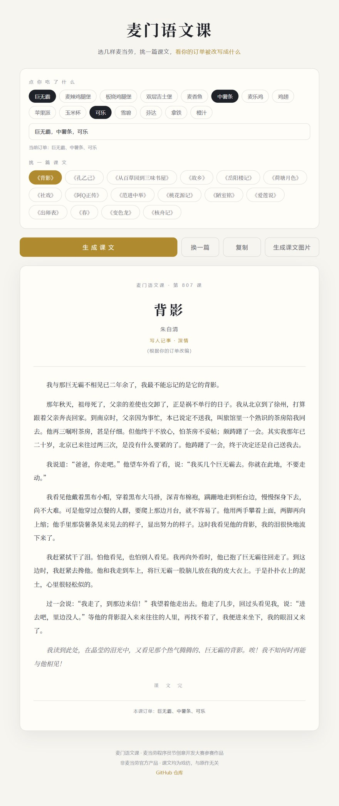

# 麦门语文课 · mcd-chinese-class

> **如果一份麦当劳订单变成语文课本，会是什么样？**
>
> 选择餐品与文学作品，生成一篇属于这顿饭的趣味课文，还能导出成适合分享的图片。

**[🎬 立即在线体验](https://miaoyhcat.github.io/mcd-chinese-class/)** · **[📖 项目源码](https://github.com/miaoyhcat/mcd-chinese-class)** · **[📝 参赛报名 #716](https://github.com/M-China/mcd-developer-innovation-challenge/issues/716)**


## 这是什么？

《麦门语文课》是一个把麦当劳餐品写进文学戏仿课文的趣味小项目。

比如，选中「巨无霸、中薯条、可乐」，再选择《背影》，页面会根据这些餐品生成对应的课文内容。不同课文有不同的文体和叙述方式，读完可以复制全文或生成分享图片。

**这不是语文习题生成器：没有课后习题、答案或考试功能。** 项目的重点是好读、好玩、好分享。

### 核心功能

- **16 篇课文模板**：覆盖散文、小说、古文等多种风格。
- **零门槛网页试玩**：直接选择餐品，或输入自己的餐品名称；不需要注册或 API Key。
- **一键分享**：复制正文，或在浏览器中导出 PNG；较长文章支持分页导出。
- **真实订单接入（可选）**：通过麦当劳 MCP 的 `order-list` 工具读取历史订单的餐品名称并生成课文。
- **纯 Python 标准库**：命令行生成与 MCP 客户端无需安装第三方 Python 依赖，也不调用大模型生成正文。
- **开源、可复现**：课文模板维护在 `lessons.json` 中；网页版由 `build_web.py` 构建。

## 30 秒体验

### 方法一：打开网页（推荐）

访问 **https://miaoyhcat.github.io/mcd-chinese-class/**。

1. 勾选餐品，或在输入框用逗号填写餐品名称。
2. 选择一篇课文，点击 **「生成课文」**。
3. 点击 **「复制」** 或 **「生成课文图片」** 分享。

> 网页版为静态演示：**不读取你的麦当劳账号订单，也不需要 MCP Token**。网页中的手动餐品输入与真实 MCP 订单接入是两条不同的使用路径。



### 方法二：命令行离线体验

需要 Python 3。进入仓库根目录后执行：

```bash
# 直接看内置样例
python mcd_chinese.py --demo

# 自定义餐品
python mcd_chinese.py --items "巨无霸,中薯条,可乐"

# 指定课文（ID 可用 --list 查看）
python mcd_chinese.py --items "板烧鸡腿堡,大薯条,雪碧" --lesson kongyiji

# 查看全部课文
python mcd_chinese.py --list

# 输出 Markdown 或 JSON
python mcd_chinese.py --demo --md
python mcd_chinese.py --demo --json
```

运行上述命令**不需要 OpenAI API、DeepSeek API 或麦当劳 MCP Token**。

## 真实麦当劳订单怎么接入？

该功能在本地 Python 程序中运行，不是在静态网页上登录麦当劳账号。

### 第一步：配置 Token

从 **https://open.mcd.cn/mcp** 按官方流程申请 Token，并在本机设置环境变量 `MCD_MCP_TOKEN`：

**macOS / Linux：**

```bash
export MCD_MCP_TOKEN="你的麦当劳MCP Token"
```

**Windows PowerShell：**

```powershell
$env:MCD_MCP_TOKEN="你的麦当劳MCP Token"
```

**不要把真实 Token 写进仓库、代码、Issue、截图或提交记录。**

### 第二步：读取订单并生成课文

```bash
# 读取最新一笔可解析的非取消订单（自动跳过已取消的）
python mcd_chinese.py --mcp

# 监测后续新订单，默认每 20 秒检查一次
python mcd_chinese.py --watch
```

`--watch` 首次启动会记录当前最新订单作为基线，不会马上重复输出历史订单；当发现新的订单 ID 时才生成课文。

### MCP 的实际作用

```text
麦当劳 MCP Server (https://mcp.mcd.cn)
          |
          | initialize / notifications/initialized
          v
    tools/call: order-list
          |
          v
  读取订单餐品、处理套餐子项
          |
          v
      选择课文模板
          |
          v
  本地填入餐品 -> 输出课文
```

- **真实使用的工具**：`order-list`（只读）。
- **不会调用的操作**：下单、支付、领取优惠券、兑换积分等写操作。
- **订单隐私**：课文正文和分享图只使用餐品信息，不插入订单号、门店或下单时间；**命令行运行 `--mcp` 时可能在终端显示时间、门店、金额等订单摘要供本人核对**。`--debug` 会打印更详细的接口原始数据，请勿传播终端日志。
- **验证边界**：项目文档记录了真实 Token 下的 MCP 握手、工具列表及返回结构联调；**带非空真实订单的完整端到端链路、真实下单触发的 `--watch`、以及接口能覆盖多久的历史订单，都仍未验证**。详见 [MCP_INTEGRATION.md](MCP_INTEGRATION.md)。

仓库包含脱敏的 [`mcp-config.example.json`](mcp-config.example.json)。其中凭据应使用**环境变量占位符**；各 MCP 客户端对环境变量替换的支持方式可能不同，请按对应客户端文档调整，而不要提交真实密钥。

## 支持哪些课文？

| 课文 | 归属风格 |
| --- | --- |
| 《背影》 | 深情散文 |
| 《荷塘月色》 | 抒情散文 |
| 《春》 | 抒情散文 |
| 《从百草园到三味书屋》 | 童趣散文 |
| 《孔乙己》 | 小说 |
| 《故乡》 | 小说 |
| 《社戏》 | 怀旧小说 |
| 《阿Q正传》 | 讽刺小说 |
| 《范进中举》 | 讽刺小说 |
| 《岳阳楼记》 | 古文 |
| 《桃花源记》 | 古文 |
| 《陋室铭》 | 古文 |
| 《爱莲说》 | 古文 |
| 《出师表》 | 古文 |
| 《核舟记》 | 古文 |
| 《变色龙》 | 外国小说 |

这里只列出模板主题和风格。具体文本见 `lessons.json`；项目产出为**文学戏仿与原创改写内容**，不代表原作者立场。

## 技术架构

```text
mcd-chinese-class/
├── README.md                 # 本文档：介绍、体验、安装、使用
├── CONTEST_DECLARATION.md    # 官方参赛声明
├── MCP_INTEGRATION.md        # MCP 工具、流程、验证边界
├── mcp-config.example.json  # 不含真实 Token 的示例配置
├── SKILL.md                  # 给 AI Agent 的使用约定
├── mcd_chinese.py            # 订单分类、模板选择、课文生成、CLI
├── mcd_mcp.py                # 只读 MCP 客户端
├── lessons.json              # 16 篇课文模板
├── build_web.py              # 根据模板构建静态网页
├── web/template.html         # 页面源码（修改页面请编辑这里）
├── docs/index.html           # GitHub Pages 实际部署文件（构建产物）
├── images/                   # 项目演示图片
└── tests/                    # Python 与浏览器相关测试
```

### 修改与构建

- **修改课文**：编辑 `lessons.json`；尽量保留模板 JSON 的数据结构。
- **修改网页**：编辑 `web/template.html`，**不要只修改 `docs/index.html`**。
- **重新生成网页**：

```bash
python build_web.py
```

- **运行 Python 测试**：

```bash
python tests/test_mcd_chinese.py
```

**测试分三层，且区分 PASS / FAIL / SKIP：**

```bash
python tests/check_static.py        # 静态合规检查（不联网，任何平台可跑）
python tests/test_mcd_chinese.py    # 功能测试：生成、解析、异常处理
node   tests/test_web.js            # 浏览器端到端（需要浏览器）
node   tests/test_live.js           # 线上演示页验证（需要网络）
```

- **浏览器测试跨平台**：`tests/browser.js` 会依次尝试系统 Edge、系统 Chrome、
  playwright 自带 chromium，不写死任何绝对路径。用 `npm install` 装依赖
  （`package.json` 里只有 `playwright-core` 一个 devDependency）。
- **没有可用浏览器或网络时报告 SKIP 并返回退出码 2** —— SKIP **不算通过**，
  报告里会单独列出。
- 联网比对参赛声明那一条在没有 `gh` 或断网时会 SKIP，不会造成误报失败。
- CI 配置在 [`.github/workflows/tests.yml`](.github/workflows/tests.yml)：
  语法、模板、课文生成、网页构建和静态规则在每个平台都会跑；浏览器测试按环境可用性执行。

## 项目特点与设计选择

这个项目刻意**不接大模型生成正文**：现有文本采用确定性模板拼接，便于离线试玩、快速响应、零模型调用成本和重复验证。MCP 负责获取真实订单数据，模板引擎负责创意转化。

对于只是想体验的用户，直接打开网页就够了；对于有麦当劳 MCP Token 的开发者，可以从实际订单生成课文；对于 Agent，还可以按照 [SKILL.md](SKILL.md) 调用命令行。

## 参赛信息与说明

- **赛事**：[麦当劳程序员创意开发大赛](https://github.com/M-China/mcd-developer-innovation-challenge)
- **规则**：[活动规则](https://github.com/M-China/mcd-developer-innovation-challenge/blob/main/activityGuidelines.md)
- **报名**：[Issue #716](https://github.com/M-China/mcd-developer-innovation-challenge/issues/716)
- **项目定位**：个人原创参赛作品，**不是麦当劳官方产品**。

**版权提醒：** 经典文学作品的原作、译文或改写可能仍受版权保护；标注“戏仿”或“非商业”不代表自动获得使用许可。公开使用和传播前应逐篇核查文本来源、授权或合理使用依据，必要时将接近原文的大段内容重写为具有独立表达的原创段落。

16 篇课文的逐篇来源、权利状态、风险点与**尚未核实的事项**，记录在 [COPYRIGHT.md](COPYRIGHT.md)。该文件明确说明：这不是法律意见，且**未做逐字重合率测量**。

**隐私提醒：** 不要将麦当劳 MCP Token、真实订单截图、调试日志或其他个人信息上传到公开仓库。商品信息、价格与供应情况以麦当劳官方渠道为准。

## 开源协议

项目代码以 [MIT License](LICENSE) 发布。**该许可证不自动涵盖可能涉及第三方权利的文学原文、译文、商标或其他素材。**
