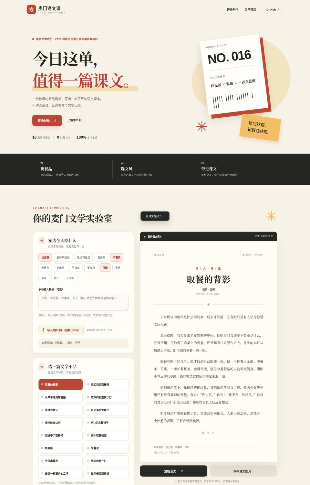
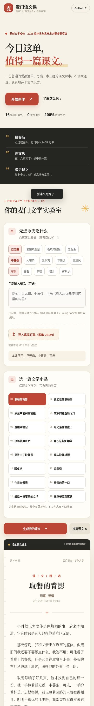

<div align="center">

# 📖 麦门语文课

### 今日这单，值得一篇课文。

**一份麦当劳订单，十六种原创文学戏仿。** 选好餐品，几秒钟生成自己的“语文课文”。

[🎬 **在线体验**](https://miaoyhcat.github.io/mcd-chinese-class/) · [📋 比赛报名 #716](https://github.com/M-China/mcd-developer-innovation-challenge/issues/716) · [🔎 MCP 技术实现](MCP_INTEGRATION.md)

</div>

> **程序员创意开发大赛作品** · 无付费 API · Python 标准库 · 完整静态网页 · 只读 MCP · 本地隐私优先
>
> 本项目非麦当劳官方产品。文学戏仿文章为独立创作，并非原著文字替换或官方教材。

## ✨ 三步开始

1. **挑餐品**：点击巨无霸、薯条、可乐等快捷选项，也能输入自己的餐品。
2. **选课文**：从十六篇原创文学小品中挑风格；每篇都有独立的小故事。
3. **带走课文**：一键复制全文，或导出适合手机分享的高清 PNG 图片；长文按页导出。

**最快体验：直接点击 [网页演示](https://miaoyhcat.github.io/mcd-chinese-class/)，无需账号、Token 或安装。** 网页仅在本地运算，没有广告、远程 AI 请求或第三方追踪。

## 📷 页面预览



<details><summary>📱 查看手机端截图</summary>



</details>

项目的前端源码在 `web/`，成品 `docs/index.html` 为独立单文件，可直接由 GitHub Pages 托管。

> 提交新版本后，可用浏览器打开在线体验链接。开发者运行 `python build_web.py` 即可重新生成网页。

## 📚 十六篇原创课文

| 作品 | 文学灵感 | 关键词 |
|---|---|---|
| 取餐的背影 | 《背影》 | 温情、家人 |
| 孔乙己的取餐码 | 《孔乙己》 | 人物、幽默 |
| 从菜单墙到靠窗座 | 《从百草园到三味书屋》 | 童趣、观察 |
| 故乡的那盏餐厅灯 | 《故乡》 | 记忆、友谊 |
| 登楼观餐记 | 《岳阳楼记》 | 古风、见闻 |
| 月光落在餐盘上 | 《荷塘月色》 | 深夜、独处 |
| 夜场散席以后 | 《社戏》 | 热闹、友谊 |
| 阿Q的点餐哲学 | 《阿Q正传》 | 自嘲、喜剧 |
| 范进中了取餐号 | 《儒林外史》人物故事 | 幽默、荒诞 |
| 误入取餐桃源 | 《桃花源记》 | 古风、奇遇 |
| 陋桌铭 | 《陋室铭》 | 短章、风趣 |
| 爱薯说 | 《爱莲说》 | 议论、分享 |
| 今日出餐表 | 《出师表》 | 书信、趣谈 |
| 春天的第一口 | 《春》 | 明朗、生活 |
| 最后一根薯条的立场 | 《变色龙》 | 对话、反转 |
| 微型餐盘观察记 | 《核舟记》 | 说明、细节 |

所有正文存放于 [`lessons.json`](lessons.json)。保留“文学语气”和巧妙的生活反差，不整段复制仍可能受版权保护的现代原著。餐品变量 `{main}`、`{side}`、`{drink}`、`{items}`、`{count}`、`{kinds}` 由订单替换。**没有课后习题。**

## 🔗 真实麦当劳 MCP：不只是离线玩具

除了网页体验，项目还通过官方麦当劳 MCP 的 **`order-list`** 只读工具获取真实历史订单。实际调用流程：

```text
用户授权并在本机配置 Token
           │
           ▼
麦当劳 MCP Server ─ order-list (只读)
           │
           ▼
解析最近有效订单 → 识别餐品、份数与套餐子项
           │
           ▼
      生成文学课文
           │
           ├─ 直接显示终端输出
           └─ 导出仅含餐品名称/数量的 JSON → 浏览器生成并分享
```

### 本地使用（Python 3.10+）

无需安装任何依赖：

```bash
python mcd_chinese.py --demo
python mcd_chinese.py --items "巨无霸,中薯条,可乐" --lesson beiying
python mcd_chinese.py --list
python mcd_chinese.py --demo --md
python mcd_chinese.py --demo --json
```

### 使用真实订单

1. 从 [麦当劳 MCP 平台](https://open.mcd.cn/mcp) 按官方流程申请令牌。
2. 在自己电脑的终端设置 `MCD_MCP_TOKEN` 环境变量，不要发在聊天或 Issue 里。
3. 运行只读查询命令：

```bash
# macOS / Linux
export MCD_MCP_TOKEN="你的令牌"

# Windows PowerShell 另用此命令：
# $env:MCD_MCP_TOKEN="你的令牌"

python mcd_chinese.py --mcp

# 需要在网页里分享时，只导出商品名称与数量：
python mcd_chinese.py --mcp --export-web order-local.json
```

打开网页，选择「导入真实订单（脱敏 JSON）」，上传你刚刚生成的 `order-local.json`。**浏览器不会拿到 Token、原始订单号、门店、价格和个人信息。**

也可以使用：

```bash
python mcd_chinese.py --watch --interval 30
```

`--watch` 只处理启动后新增的订单，默认 30 秒检查一次；首次只记住当前最新订单，不会把历史订单误判为新单。停止请按 `Ctrl+C`。

> **真实验证边界：** 本次重构针对 MCP 协议、订单结构、套餐和异常情况做了离线模拟测试，但**没有你的真实 Token，尚未在真实非空订单上完成重构版的端到端联调**。发布前请验证实际订单流程，详见 [`MCP_INTEGRATION.md`](MCP_INTEGRATION.md)。

## 🧱 技术架构

| 模块 | 文件 | 职责 |
|---|---|---|
| 生成内核 | `engine.py` | 输入校验、分类、原创新课文渲染、稳定课号、脱敏输出 |
| MCP 客户端 | `mcd_mcp.py` | Streamable HTTP / JSON-RPC、只读 `order-list`、订单解析 |
| CLI | `mcd_chinese.py` | 命令行入口、真实订单、监控和 JSON 导出 |
| 课文库 | `lessons.json` | 16 篇独立原创文学小品 |
| 餐品词典 | `catalog.json` | 前后端统一的餐品分类规则与快捷选项 |
| 网页源码 | `web/template.html`, `web/style.css`, `web/app.js` | 手机友好 UI、文本安全渲染、PNG 导出、导入文件 |
| 构建 | `build_web.py` | 数据与资源注入单文件网页 |
| 演示产物 | `docs/index.html` | GitHub Pages 静态首页，单文件自包含 |
| 自动化测试 | `tests/` | Python 生成/MCP/构建/浏览器测试 |
| AI Skill | `SKILL.md` | Agent 的触发方式、命令、权限界限 |

### 重新构建和测试

```bash
python build_web.py
python -m unittest discover -s tests -p "test_*.py" -v
```

浏览器端到端测试需额外安装 **仅供测试使用** 的 Playwright（不影响项目运行零依赖）：

```bash
python -m pip install playwright
python -m playwright install chromium
python tests/browser_smoke.py
```

## 🛡 隐私与安全

- MCP Token 只在本地环境变量中读取，未被写进网页、JSON 导出物或仓库。
- MCP 客户端**只允许调用 `order-list`**，没有下单、支付、领券、积分兑换等接口。
- 服务错误默认不打印原始响应；生成文件只含商品名和数量。
- 网页使用 DOM `textContent` 输出用户内容，避免通过 `innerHTML` 注入脚本；数据内联时转义危险脚本分隔符。
- 无遥测，无第三方 CDN，无后端服务器。详见 [`SECURITY.md`](SECURITY.md)。

## 🏆 比赛与合规

本项目参与 [麦当劳程序员创意开发大赛](https://github.com/M-China/mcd-developer-innovation-challenge)：

- 参赛申请：[Issue #716](https://github.com/M-China/mcd-developer-innovation-challenge/issues/716)
- 活动规则：[activityGuidelines.md](https://github.com/M-China/mcd-developer-innovation-challenge/blob/main/activityGuidelines.md)
- 必需文件：[参赛声明](CONTEST_DECLARATION.md) · [MCP 集成说明](MCP_INTEGRATION.md) · [脱敏配置](mcp-config.example.json)
- 合规与验证：[版权说明](COPYRIGHT.md) · [测试与验证记录](TEST_REPORT.md) · [安全说明](SECURITY.md)
- 未申报 WorkBuddy 专项，也没有伪造 WorkBuddy 集成证明。

比赛奖项和排名按 **官方 Star 排名与资格审核** 认定。零 Star 项目不进入排行榜，只有进入最终榜单且合规审核通过才有获奖资格；本仓库不包含刷 Star 或榜单操作工具。

**知识产权说明：** 本仓库网页及代码采用 MIT 许可证。十六篇课文均为新写的原创文字，只借经典作品的情境与语气，不整段复制原著；逐篇的灵感来源、公有领域状态与仍然存在的风险写在 [COPYRIGHT.md](COPYRIGHT.md) 里（它同时列出了尚未做的核查，不是法律意见）。作品上线前请由仓库维护者复查涉及的文字、图像和品牌素材，合理权利人可通过 [Issues](https://github.com/miaoyhcat/mcd-chinese-class/issues) 联系。

## ❤️ 适合谁

- 想把一顿麦当劳吃出一点文学感的人；
- 喜欢文学戏仿、段子和轻量互动网页的人；
- 想学习只读 MCP、确定性模板生成及静态网页构建的开发者。

如果你觉得有趣，欢迎分享体验链接或提出改进建议。感谢每一次真实的使用与反馈。
