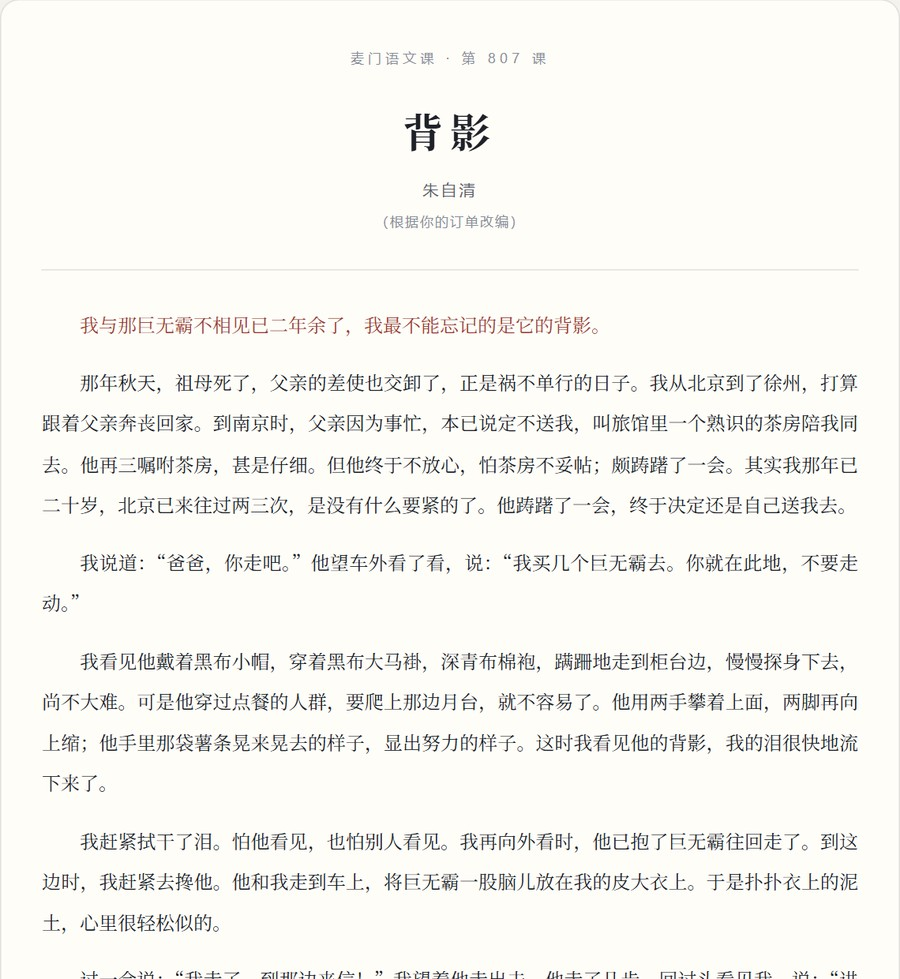

# 麦门语文课 · mcd-chinese-class

> 选几样麦当劳，挑一篇课文 —— **看你的订单被改写成什么。**

**🎬 在线体验（不用装任何东西，打开就能玩）：**
**https://miaoyhcat.github.io/mcd-chinese-class/**



---

## 这是什么

别人把麦当劳数据做成计算器，这个做成**语文课本**。

你点了一份「巨无霸 + 中薯条 + 可乐」，它把这一单改写成《背影》：

> 我与那巨无霸不相见已二年余了，我最不能忘记的是它的背影。
>
> 我说道：“爸爸，你走吧。”他望车外看了看，说：“我买几个巨无霸去。你就在此地，不要走动。”
>
> 我看见他戴着黑布小帽，穿着黑布大马褂，深青布棉袍，蹒跚地走到柜台边，慢慢探身下去，尚不大难。可是他穿过点餐的人群，要爬上那边月台，就不容易了。他用两手攀着上面，两脚再向上缩；他手里那袋薯条晃来晃去的样子，显出努力的样子。这时我看见他的背影，我的泪很快地流下来了。

每一篇都按原课文的结构改写，连**课后习题**都配好了：

> 1. 文中“我买几个巨无霸去”一句单独成段，有什么表达效果？
> 2. 作者描写父亲越过柜台、攀上月台的细节，用了哪些动词？这样写有什么好处？
> 3. 本文题为《背影》，如果改成《巨无霸》，表达效果会有什么变化？

## 六篇课文

| 课文 | 作者 | 调性 |
|---|---|---|
| 《背影》 | 朱自清 | 深情 |
| 《孔乙己》 | 鲁迅 | 冷峻（“窃薯条不能算偷……窃薯条！”）|
| 《从百草园到三味书屋》 | 鲁迅 | 童趣 |
| 《故乡》 | 鲁迅 | 沉郁（“回到相隔二十分钟、别了三天的麦当劳去”）|
| 《岳阳楼记》 | 范仲淹 | 文言（“先餐之饱而饱，后餐之饿而饿”）|
| 《荷塘月色》 | 朱自清 | 抒情（“弥望的是田田的薯条”）|

## 目标用户

- 想吃麦当劳时想找点乐子的人
- 想发朋友圈 / 小红书但缺一张图的人
- 语文老师（真的，这份材料可以拿来当“改写”的课堂引子）
- 任何还记得《背影》全文的人

## 在线体验

打开 **https://miaoyhcat.github.io/mcd-chinese-class/** 就能玩：

1. 点几样你吃的（也可以直接打字）
2. 挑一篇课文
3. 生成，截图，发出去

整个页面是**单文件、零依赖、零网络请求**的，双击 `docs/index.html` 也能离线打开。

## 本地使用（命令行）

不需要安装任何第三方库，只用 Python 标准库。

```bash
# 内置样例，不需要任何 Token，跑起来就先看效果
python mcd_chinese.py --demo

# 自己指定餐品
python mcd_chinese.py --items "板烧鸡腿堡,大薯条,雪碧"

# 指定课文
python mcd_chinese.py --items "巨无霸,可乐" --lesson kongyiji

# 看看有哪些课文可选
python mcd_chinese.py --list

# 输出 Markdown / JSON（便于二次加工）
python mcd_chinese.py --demo --md
python mcd_chinese.py --demo --json
```

### 读取你的真实订单

配置麦当劳 MCP Token 后，可以直接拿最近一笔订单来改编：

```bash
# 申请 Token：https://open.mcd.cn/mcp
export MCD_MCP_TOKEN="你的token"      # Windows PowerShell: $env:MCD_MCP_TOKEN="..."
python mcd_chinese.py --mcp
```

## 麦当劳 MCP 接入

本项目通过麦当劳官方 MCP Server 的 **`order-list`** 工具读取订单历史，全程**只读**。

- 接入地址：`https://mcp.mcd.cn`（Streamable HTTP）
- 用到的工具：`order-list`（订单历史）
- 未使用任何写操作：不下单、不支付、不领券、不兑换积分
- 客户端 `mcd_mcp.py` 内置**只读白名单**，即使有人改了调用代码，写操作也会在客户端被挡下

详细的调用流程、协议细节和踩坑记录见 **[MCP_INTEGRATION.md](MCP_INTEGRATION.md)**。

## 为什么不用大模型

生成过程是**确定性**的：同一份订单永远得到同一篇课文。

这不是偷懒 —— 恰恰是因为不依赖 LLM，它才能：

1. **离线可用**：网页版双击就能开，不需要联网也不需要 API Key
2. **零成本**：不会因为别人来玩就烧掉你的 token
3. **可复现**：出问题能精确定位到哪条模板
4. **当 Skill 用**：AI Agent 也可以直接调用它，输出稳定

## 项目结构

```
mcd-chinese-class/
├── mcd_chinese.py      # 主程序：分类餐品 → 选课文 → 渲染
├── mcd_mcp.py          # 麦当劳 MCP 最小客户端（标准库，只读白名单）
├── lessons.json        # 课文模板库（占位符驱动，可自行加课文）
├── build_web.py        # 把模板内联进 HTML，产出单文件演示页
├── docs/index.html     # 构建产物：GitHub Pages 演示页（自包含）
├── web/template.html   # 演示页源模板
└── SKILL.md            # Agent Skill 定义（给 AI 客户端用）
```

## 自己加一篇课文

`lessons.json` 是数据驱动的，加一篇只要追加一个对象：

```json
{
  "id": "shexi",
  "title": "社戏",
  "author": "鲁迅",
  "tag": "小说 · 怀旧",
  "opening": "我们鲁镇的习惯，本来是凡有出嫁的女儿，倘自己还未当家，夏间便大抵回到母家去消夏。",
  "body": ["……{main}……", "……{side}……"],
  "ending": "真的，一直到现在，我实在再没有吃到那夜似的好{side}。",
  "questions": ["……"]
}
```

可用占位符：`{main}` 主食 · `{side}` 小食 · `{drink}` 饮品 · `{items}` 全部餐品 · `{count}` 件数 · `{store}` 门店。

改完跑一次 `python build_web.py` 重新生成演示页。

## 免责声明

- 本项目是**麦当劳程序员节创意开发大赛参赛作品**，由参赛者独立开发，**非麦当劳官方产品**。
- 课文均为**戏仿**，与原作、原作者的立场无关，也不代表任何对原作的评价。
- 餐品信息、价格及供应状态以麦当劳官方渠道的实时结果为准。
- 本项目不含任何真实 Token、密钥或他人个人信息，配置一律走环境变量。

## 开源协议

[MIT](LICENSE)
